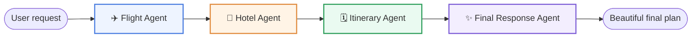

<div align="center">

# ✈️ AI Travel Planning System

A **multi-agent travel planner** powered by [LangGraph](https://www.langchain.com/langgraph) and [FastAPI](https://fastapi.tiangolo.com/).

Describe your trip in plain English — the system coordinates a small team of specialist agents to find flights, scout hotels, build a day-by-day itinerary, and deliver a polished final plan.


</div>

---

## 🧠 How it works

A user request is routed through a linear graph of **four specialist agents**. Each agent owns one slice of the trip and passes its output downstream.



| Agent | Job | Tools |
|-------|-----|-------|
| **Flight Agent** | Resolves origin/destination into IATA codes and queries live flight status | [Aviationstack](https://aviationstack.com/) |
| **Hotel Agent** | Searches the web for top hotel options in the destination | [Tavily](https://tavily.com/) |
| **Itinerary Agent** | Crafts a practical, budget-aware day-by-day plan | Inception Mercury-3 |
| **Final Response Agent** | Formats everything into a polished trip report | Inception Mercury-3 |

Each step is **checkpointed to PostgreSQL**, so multi-turn conversations keep their state via a stable `thread_id`.

---

## 🗂️ Project structure

```text
.
├── app.py                     # FastAPI app (routes, host, static files)
├── backend.py                 # LangGraph state, agents, graph + checkpointer
├── requirements.txt
├── test.py                    # Quick smoke test
├── static/
│   ├── style.css              # Frontend styling
│   └── script.js              # Chat UI + markdown rendering
├── templates/
│   └── index.html             # Single-page chat layout
└── tools/
    ├── flight_tool.py         # Aviationstack flight search
    └── tavily_tool.py         # Tavily web search
```

---

## 🚀 Getting started

### 1. Prerequisites

- Python 3.11+
- A PostgreSQL database (used for graph checkpoints)

### 2. Environment variables

Copy these into a `.env` file in the project root. The app will not start without the required keys.

| Variable | Required | Purpose |
|----------|----------|---------|
| `DATABASE_URL` | ✅ | PostgreSQL connection string for checkpoints |
| `INCEPTION_API_KEY` | ✅ | LLM API key (Inception Mercury-3) |
| `TAVILY_API_KEY` | ✅ | Web search for hotels |
| `AVIATIONSTACK_API_KEY` | ✅ | Live flight lookup |
| `DEFAULT_ORIGIN_IATA` | ❌ | Default origin airport (default `DAC`) |

> 🔒 Never commit `.env`. It is already listed in `.gitignore`.

### 3. Install and run

```bash
# Create a virtual environment
python -m venv .venv
source .venv/bin/activate

# Install dependencies
pip install -r requirements.txt

# Start the server
python app.py
```

Open **[http://127.0.0.1:8000](http://127.0.0.1:8000)** in your browser.

---

## 🖥️ API

| Method | Endpoint | Description |
|--------|----------|-------------|
| `GET` | `/` | Serves the chat UI |
| `GET` | `/health` | Health check |
| `POST` | `/api/travel` | Run the travel agent for a message |

**Example request**

```bash
curl -X POST http://127.0.0.1:8000/api/travel \
  -H "Content-Type: application/json" \
  -d '{"message": "Plan a 3-day trip to Paris from Kathmandu"}'
```

**Response**

```json
{
  "success": true,
  "thread_id": "user_...",
  "answer": "…final formatted plan…",
  "flight_results": "…",
  "hotel_results": "…",
  "itinerary": "…",
  "llm_calls": 4
}
```

> Reuse the returned `thread_id` in later messages to continue the same conversation with full memory.

---

## 🧪 Testing

A minimal smoke test runs the agent end-to-end and prints the final answer:

```bash
python test.py
```

---

## 🛠️ Tech stack

- **Orchestration** — LangGraph, `PostgresSaver` checkpointing
- **LLM** — Inception Mercury-3 (OpenAI-compatible endpoint)
- **Backend** — FastAPI, Pydantic, Uvicorn
- **Frontend** — Jinja2, vanilla HTML/CSS/JS
- **Integrations** — Aviationstack, Tavily

---

## 📜 License

© 2026 Ashish X AI Engineering. Feel free to build on it.
